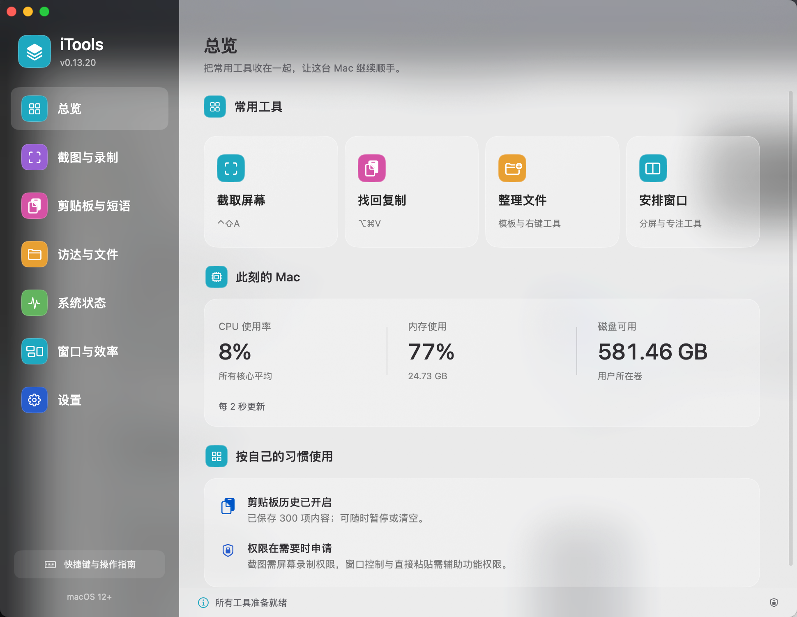
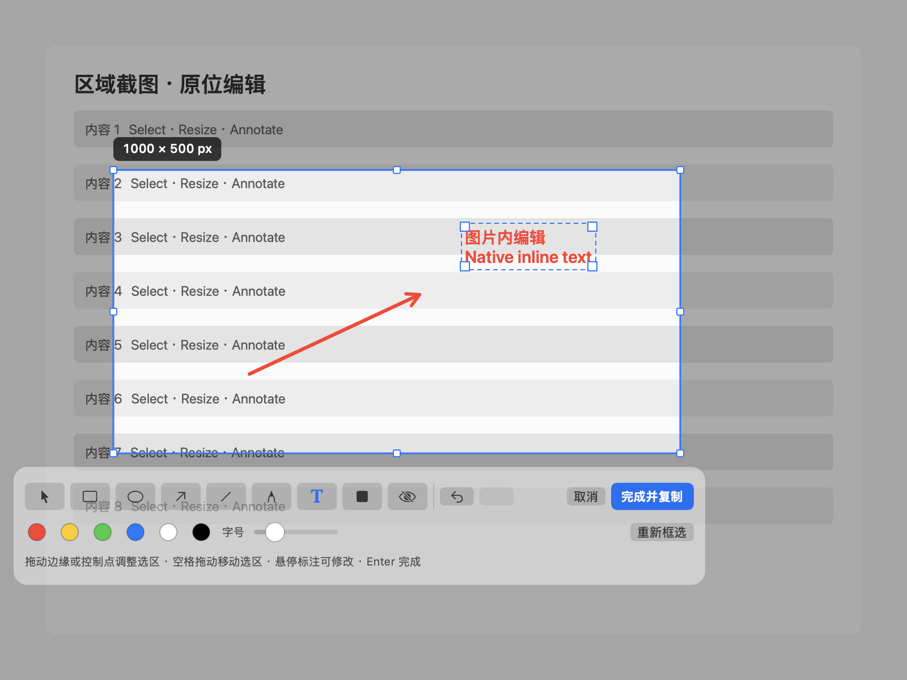
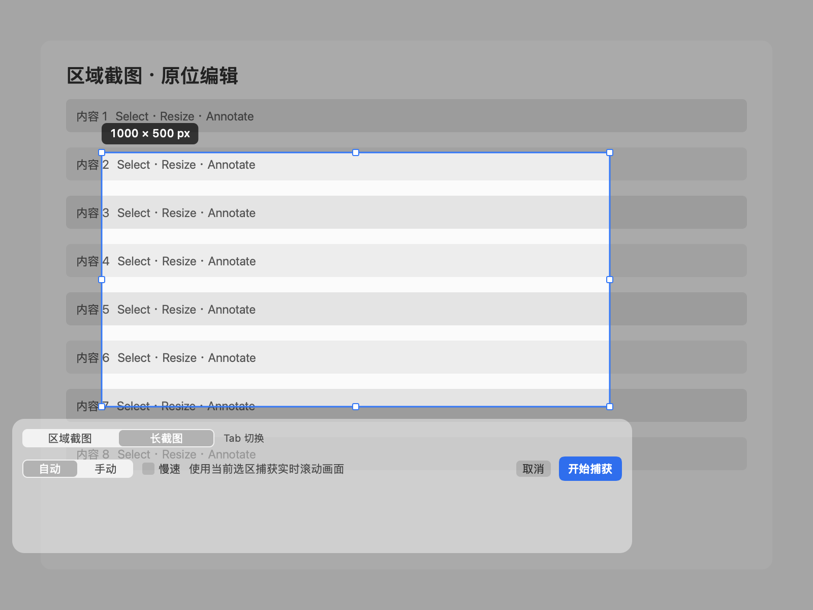
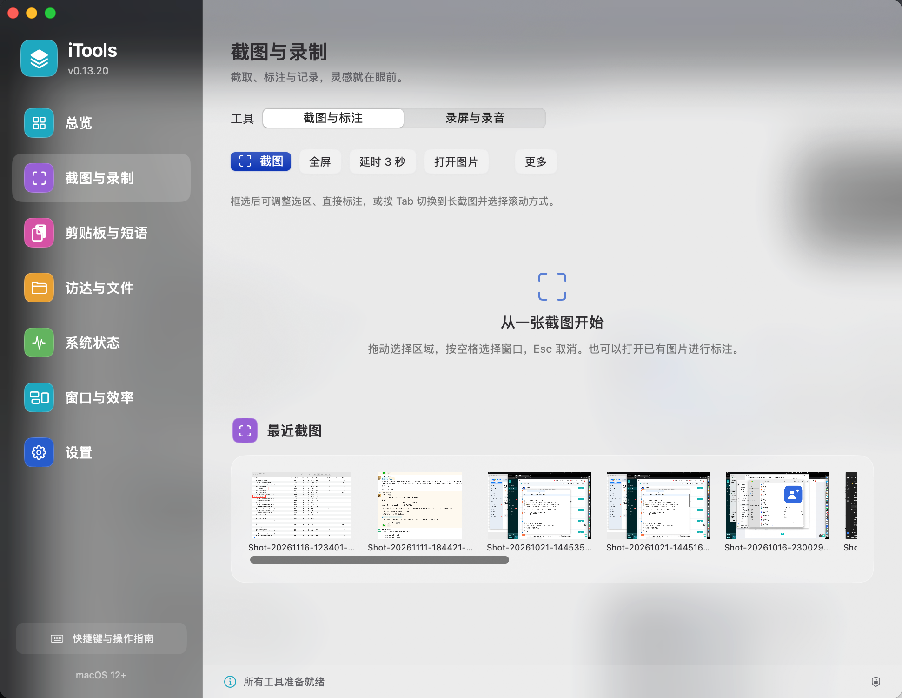
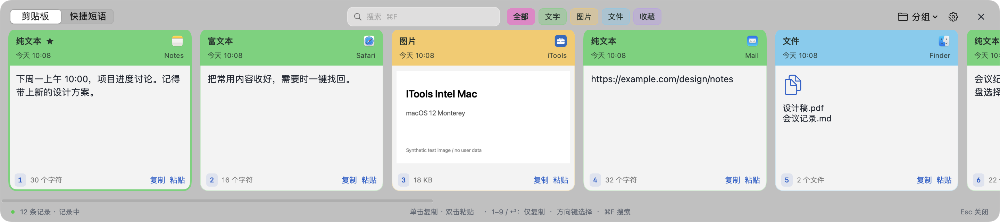
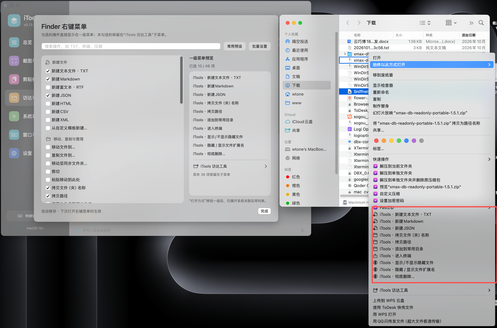
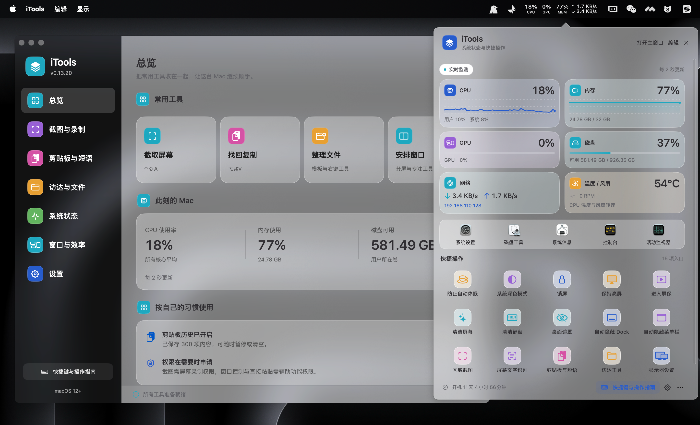
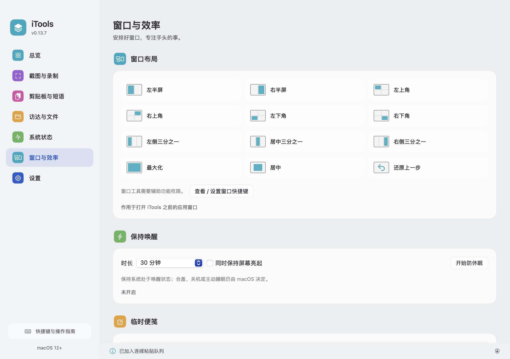

# iTools · macOS 工具箱

一款使用 SwiftUI 和 AppKit 开发的 macOS 菜单栏工具箱，将截图、录屏、剪贴板、访达工具、系统监控和窗口管理集中在一个应用中。界面为中文，功能按需启用，常用操作主要在本机完成。



## 核心功能

### 截图：区域截图与长截图

用快捷键框选一次，在同一工具栏中选择区域截图或长截图，适合截取聊天记录、网页和操作步骤。

- **区域截图**：支持框选、窗口、主屏和延时截图，选区内可直接添加文字、箭头等标注。还提供裁剪、贴图、取色、离线中英文 OCR 和二维码识别。
- **长截图**：框选后按 `Tab` 或点击「长截图」，选择自动或手动滚动，再开始捕获；完成后自动拼接、保存并复制。



*区域截图标注示例，工具栏样式来自较早版本。*



*长截图模式示例，画面使用合成测试内容。*

### 录屏与录音

录制主屏幕或选定区域，也可单独录音，适合制作演示和操作教程。

- 可选择帧率和音频输入，录制过程中支持暂停、继续和停止保存。
- 提供视频裁剪、压缩与 GIF 导出；GIF 转换支持 30 秒以内的视频。
- 录制系统声音需自行配置虚拟音频输入；应用不会自动安装音频驱动。



*「截图与录制」页面示例，可在顶部切换到「录屏与录音」。*

### 超级剪贴板：剪贴历史与快捷短语

集中查找和复用复制过的内容，减少在应用间反复切换和复制。

- 支持文本、富文本、图片和文件历史，以及搜索、收藏、分组和导入导出。
- 可用粘贴队列连续处理多条内容，也可管理常用快捷短语。
- 历史记录默认关闭，需手动开启；可设置排除应用、保留期限和容量。



*剪贴板历史面板示例。*

### 超级右键菜单：Finder 文件操作

启用 iTools Finder 扩展后，可在访达右键菜单中使用常见文件工具。

- 支持模板新建文件、整理与重命名、复制和移动等操作。
- 还可使用压缩、校验及隐藏文件切换等工具，并在应用中调整右键菜单。
- 首次使用需在系统设置中启用扩展；主程序中的文件工具可独立使用。



*配置常用操作，并在 Finder 右键菜单中直接使用。*

### 系统状态监控

查看 CPU、内存、GPU、磁盘、网络、电池、温度和风扇等信息，并选择需要显示在菜单栏的指标。部分传感器能否读取取决于机型与驱动。



*菜单栏指标与系统状态、快捷操作面板。*

### 分屏与窗口管理

通过窗口布局按钮或快捷键，将当前应用窗口排列到左半屏、右半屏、四分之一屏等位置，也可最大化或还原先前布局。窗口控制需要辅助功能权限。



*窗口布局及其他效率工具示例。*

应用还提供定时防休眠、便笺、链接清理和本地二维码生成等工具。部分界面示例来自较早版本，实际界面以当前构建为准。

详细行为与已知限制见[功能矩阵](docs/FEATURES.md)、[截图与长截图](docs/CAPTURE-WORKFLOW.md)和[快捷键指南](docs/SHORTCUTS.md)。

## 系统要求

- macOS 12 Monterey 或更新版本；构建目标支持 Intel 和 Apple Silicon。
- 从源码构建需要 Xcode 15 / Swift 5.9 或更新版本、macOS SDK 和 Python 3。
- 部分能力需要在系统设置中授权，详见下方[权限与隐私](#权限与隐私)。Intel 和 macOS 12 的完整实机验收仍需进一步完成。

## 从源码构建

下载或克隆本仓库后，在仓库根目录运行：

```sh
# 首次在本机创建固定的开发签名身份
python3 scripts/setup-local-signing.py

# 构建 Intel + Apple Silicon 通用应用
ARCH=universal ./scripts/build.sh

# 启动构建产物
open dist/iTools.app
```

构建产物位于 `dist/iTools.app`；`dist/` 不纳入 Git，因此克隆仓库后需要先构建。也可用 `ARCH=arm64 ./scripts/build.sh` 或 `ARCH=x86_64 ./scripts/build.sh` 构建单架构版本。构建脚本编译并签名主程序、Finder 扩展、登录辅助程序及文件操作组件，缓存位于 `.build/`。

开发签名身份保存在当前用户的专用钥匙串中，后续构建复用同一身份；它不是 Apple Developer ID 签名或公证。对外分发需自行完成正式签名、公证和目标系统验收；设置正式签名身份的方法见[开发文档](docs/DEVELOPMENT.md)和[签名与权限](docs/PERMISSIONS.md)。建议将应用放在固定位置后再授权，避免多个副本同时运行。

## 首次使用

1. 打开 iTools，在「设置」中启用需要的模块。关闭主窗口后应用仍留在菜单栏；通过菜单栏菜单或 `⌘Q` 退出。
2. 截图和录屏需要屏幕录制权限；窗口控制、直接粘贴和自动滚动长截图需要辅助功能及相关事件发送权限。根据应用提示前往系统设置授权，必要时重新打开应用。
3. 录音时按需授权麦克风；系统声音目前需要用户自行配置虚拟音频输入。
4. 要在 Finder 中使用右键菜单，在「访达与文件」中打开扩展管理界面并启用 iTools Finder。未启用扩展时仍可使用主程序中的文件工具。
5. 剪贴板历史默认关闭；启用后开始记录新的复制内容。可在设置中调整排除应用、保留期限和容量。

## 截图与常用快捷键

默认按 `⌥⇧4` 或点击「截图」后框选；选区可移动、调整和标注。按 `Tab` 或点击工具栏标签，在区域截图与长截图之间切换。长截图使用同一选区，选择自动或手动滚动后点击「开始捕获」；自动模式无法继续时可改为手动。长截图开始前已有标注不会保留，应用会提示。

| 默认快捷键 | 操作 |
| --- | --- |
| `⌥⇧4` | 截图；框选前按空格可选择窗口 |
| `⌥⇧T` | 截屏后识别文字 |
| `⌥⌘V` | 打开剪贴板面板 |
| `⌥⌘B` | 粘贴队列下一项 |
| `⌃⌥←` / `⌃⌥→` / `⌃⌥↑` | 左半屏 / 右半屏 / 最大化 |
| `⌥⌘/` | 打开快捷键与操作指南 |

快捷键可在应用内修改和检查冲突。截图保存为 PNG 并复制到剪贴板；取消不会覆盖原图片或剪贴板。全屏截图使用主显示器。

## 权限与隐私

应用数据默认位于 `~/Library/Application Support/ITools/`。剪贴板历史与导出的备份**未额外加密**，应按敏感数据处理；截图保存在 `Captures` 目录，不会自动清理。历史默认最多保留 300 条、30 天，普通历史容量 100 MB，收藏受到保护；单条限制 10 MB，可在应用内调整适用设置。

iTools 跳过已知保密标记及排除列表中的剪贴板内容，但不能保证所有第三方应用正确标记敏感数据。截图、OCR、二维码和文件操作在本机执行；使用 Google 翻译时会先确认，再由浏览器发送所选文字。更多权限、签名及授权恢复说明见[权限文档](docs/PERMISSIONS.md)。

## 测试

```sh
# 核心测试
./scripts/test.sh

# 原生界面与截图合成检查；不读取真实桌面或系统剪贴板内容
ITOOLS_SMOKE_OUTPUT="$PWD/.build/smoke" dist/iTools.app/Contents/MacOS/ITools --smoke-test --capture-editor-check

# 真实自动滚动和截图窗口隐藏检查；仅操作专用合成窗口
./scripts/test-scroll-capture-fixture.sh
```

最后一项需要图形桌面和应用已有的屏幕录制、辅助功能及事件发送权限。真实截图路径会短暂读取所有显示器画面，但仅检查合成窗口中的内容，不保存其他画面，也不修改系统剪贴板。执行 GUI 检查时避免同时运行其他同标识的开发副本，防止重复菜单栏项或 Finder 扩展指向错误版本。

## 项目结构与文档

```text
Sources/ITools/         应用界面、菜单栏与功能服务
Sources/IToolsCore/     可测试的策略、模型与文件处理
Sources/SystemBridge/   系统统计与只读 AppleSMC 桥接
Extensions/FinderSync/  Finder 右键扩展
Helpers/                登录辅助程序
Resources/              应用清单、权限与图标资源
Tests/                  核心测试
scripts/                构建、签名与验证脚本
Vendor/7zip/            7-Zip 组件、许可及对应源码
```

[架构设计](docs/DESIGN.md) · [开发文档](docs/DEVELOPMENT.md) · [历史版本记录](docs/CHANGELOG.md) · [验证记录](docs/VALIDATION.md)

## 许可与参考

项目源码采用 [MIT License](LICENSE)。仓库中独立运行的 7-Zip 组件使用其自身的 LGPL、BSD 和 unRAR 等许可；版本、来源、许可及对应源码见 [Vendor/7zip/PROVENANCE.md](Vendor/7zip/PROVENANCE.md)。

产品设计参考了 [Vorssaint](https://github.com/vorssaint/vorssaint-utils)、[iShot](https://www.better365.cn/ishot.html)、[iRightMouse](https://www.aodo365.com/irightmouse.html)、[iCopy](https://www.aodo365.com/icopy.html) 和 [State](https://www.better365.cn/state.html)。iTools 独立实现，不包含这些产品的源码、标识或商业软件二进制，也不依赖它们运行。
