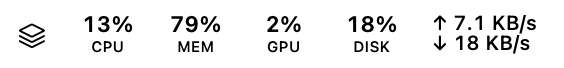

# iTools · Mac 工具箱

面向 **macOS 12 Monterey 及以上** 的原生工具箱，提供 Intel 与 Apple Silicon 通用构建。SwiftUI + AppKit 实现，菜单栏常驻，中文界面，功能按需启用，无第三方 Swift 包依赖。

这是可编译、可运行的 **0.13.13 开发版**，参考 Vorssaint 的“统一入口、按需模块、本机处理”思路，采用独立代码与品牌。它**尚未在内置功能上完全等同于 iShot、iRightMouse、iCopy 或 State**：常用能力已实现，高级差异见[功能矩阵](docs/FEATURES.md)。内置功能独立运行，不依赖这四款参考应用；0.12.3 已移除应用集成及原应用启动、图片交接入口。

## 直接运行

本目录已构建的应用位于 **dist/iTools.app**。双击打开，或：

~~~sh
open dist/iTools.app
~~~

建议把应用复制到「应用程序」后再授予权限，避免路径变化影响 macOS 权限记录。关闭主窗口后仍在菜单栏运行；从菜单栏或 ⌘Q 退出。

本机构建使用固定的本地开发证书签名，后续更新复用同一身份；它不是 Apple Developer ID 签名或公证。对外分发仍需正式签名、公证和 Intel/macOS 12 实机验收。
## 内置功能

- **截图**：区域/窗口/主屏截图、自动复制到剪贴板、连续长截图（一次框选、自动/手动滚动）、3 秒延时、可移动缩放的画笔/线条/矩形/椭圆/箭头/文字/填充色块/不透明遮盖、裁剪、浮动贴图、PNG/JPEG 导出、离线中英文 OCR、二维码识别、取色、图片纵向拼接。
- **录制**：主屏/所选区域录屏、音频输入选择、独立录音、15/30/60 fps、暂停/继续、视频时段裁剪、720p 压缩、短视频转 GIF。系统声音需已安装的虚拟音频输入。
- **剪贴板**：文本/富文本/图片/多文件历史、去重、搜索、收藏、分组、直接粘贴、纯文本粘贴、连续粘贴队列、导入/导出、排除应用、保留期限、快捷短语及日期/时间/剪贴板变量。
- **访达与文件**：带品牌的 Finder Sync 子菜单、常用目录、文本/真实模板新建、复制/移动/剪切、图标与桌面替身、AirDrop、同名文件夹与解散文件夹、重命名与乱码修复、隐藏与扩展名、写权限、磁盘扫描、ZIP/7z/AES 加密与校验、废纸篓及确认后彻底删除。
- **系统状态**：CPU、内存、交换空间、磁盘、物理网络速率、电池电量/健康/循环次数、开机时间，SMC 只读温度/风扇（CPU 温度含 Intel 与 M2 芯片适配，当前 M2 Pro 已实测），历史曲线，以及可独立开关的 CPU / 内存 / GPU / 磁盘 / 网速 / 温度 / 风扇菜单栏读数。
- **效率工具**：11 种窗口布局、还原位置、定时防休眠、自动保存便笺、链接去跟踪参数、本地二维码生成。

## 菜单项独立拖动（0.13.13）

主图标和每个指标现在都是独立的原生菜单项。按住 ⌘ 拖动任意一项即可排序，也可与其他应用的菜单项交错放置；重启和关闭再开启指标后保留原生保存的位置。继续只显示在主屏，并自动恢复刘海后被遮挡的项目。独立项使用 macOS 自身的两侧留白，不额外增加自定义边距。

## 菜单栏字体层级（0.13.12）

上方数值采用 11 点较醒目的字重，下方名称缩为 7.5 点。网速的上传与下载都是数值，两行统一为 10 点并继续左对齐。沿用固定列宽与紧凑间距，设置预览和实际菜单栏共用绘制逻辑。

## 状态图标默认靠左（0.13.11）

首次显示、旧版最右侧默认位置及「恢复可见位置」均改为状态图标区最左侧的可见位置。刘海屏会完整避开中间遮挡，不移入应用菜单区。已保存的有效手动拖动位置继续保留，扩展屏仍无占位。

## 紧凑指标与 M2 温度 / 风扇（0.13.10）

菜单栏沿用数值与标签的两行样式，各指标使用原生统一留白；普通内容列宽 28 点，网速内容列宽 58 点，上传与下载共用左侧起点。数值变化不会改变整体宽度，设置预览与菜单栏使用同一绘制逻辑。

修复 Apple Silicon 上未调用 SMC 读取的问题。M2 CPU 温度显示已读取核心的最高温度，风扇显示真实 RPM；0 RPM 表示当前停转，读取不到才显示「—」。当前 M2 Pro 已实测，其余芯片的 CPU 温度映射尚未逐一适配；无风扇或不提供相应键的机型仍显示不可用。仅读取，不控制风扇或新增特权组件。

## 刘海屏菜单栏位置恢复（0.13.9）

菜单栏指标会避开主屏刘海，正常的拖动位置继续保存。拖入刘海或越出屏幕时，松开鼠标后自动移回状态图标区靠左的可见位置；启动时也会修正超出可用区域的旧位置。可从「系统状态」点击「恢复可见位置」手动恢复，指标开关保持原样，扩展屏仍不占位。

## Finder 右键执行修复（0.13.8）

修复应用位于开发目录等位置时，Finder 沙盒误判主程序不存在、点击菜单没有响应的问题。操作组件由系统启动服务打开，沿用既有文件操作、确认和重名保护。启动失败时，错误明确交给所属 iTools 主窗口显示，避免旧预览应用接管链接；无需新增权限。

## 深色分区与指南入口（0.13.7）

主窗口深色模式移除卡片和分区的装饰描边，保留半透明底色。顶部指标信息框的固定底栏增加带文字的「快捷键与操作指南」入口，可直接打开分类指南并编辑快捷键。

## 快捷剪贴板滚轮与悬停筛选（0.13.6）

横向面板支持用普通鼠标滚轮左右浏览记录；搜索框旁的类型按钮悬停即筛选，点击仍然有效。筛选保留当前搜索内容，切换后从第一条匹配记录开始，数字键按当前筛选结果操作。原生横向触控板手势、淡色滚动条和打开后的数字键操作保留。

## 快捷剪贴板毛玻璃与数字操作（0.13.5）

整个快捷剪贴板浮框统一使用原生透明毛玻璃。分类按钮与记录标题使用对应的粉、绿、金、蓝、紫色，选中卡片带同色高亮边框；横向滚动条采用淡色细滑块。打开历史或短语面板后默认使用数字键操作记录；点击搜索框或按 ⌘F 才进入搜索，搜索期间数字作为输入。按 ↓ 或 Esc 返回记录选择后，再用数字键使用筛选结果。单击复制、双击粘贴和输入法组词保护保持有效。

## 多显示器指标浮框（0.13.3）

点击菜单栏指标时，信息浮框固定在本次点击所在的屏幕；快捷键则使用鼠标所在屏幕。浮框不会激活或移动主窗口，数据更新也不再改变菜单栏指标宽度或浮框位置。支持副屏位于主屏左、右、上、下的坐标布局；切换桌面或改变显示器配置时收起浮框，下一次点击重新定位。保留毛玻璃外观、快捷操作、Esc 关闭和点击外部关闭。

## 深色界面与系统状态管理（0.13.2）

深色模式的分区卡片与按钮适度提亮，保留半透明毛玻璃。窗口布局的 11 种排列及还原按钮增加对应图形，其中排列图形直接使用实际布局比例。菜单栏各项指标的开关、实时预览与说明统一移至「系统状态」页面顶部，原有配置自动保留。

## 记录点击操作（0.13.1）

主窗口剪贴板历史、快捷短语，以及浮动面板横向卡片与竖向列表统一为「单击复制、双击粘贴」。鼠标悬停显示操作说明；单击复制后浮动面板保持打开并显示「已复制」。双击与单击互斥，避免短语变量被重复展开。记录内独立按钮和右键菜单继续执行各自操作。数字键和回车仍使用原有偏好。

## 权限与粘贴流程（0.13.0）

- 权限不足时显示单一的前置授权说明窗口；不会同时弹系统授权提示与主窗口错误框。打开系统设置时让出前台，返回 iTools 后重新检测当前进程的实际授权状态。
- 分别检查辅助功能窗口控制与模拟键盘输入权限，显示正在运行的应用路径、版本、重新检测和重新打开入口。
- 粘贴等待目标应用成为前台且快捷键松开，再写入内容和发送粘贴按键；目标关闭、剪贴板被更新、激活超时或授权失败时不消耗队列。
- 窗口布局保留操作前的目标应用，区分权限拒绝、应用无响应、没有窗口和原生全屏限制。
- 首次从旧的临时签名版本升级，需要在系统设置中重新添加 `/Applications/iTools.app` 授权；应用不能代替用户勾选权限。具体恢复步骤和构建签名说明见[权限说明](docs/PERMISSIONS.md)。

## 半透明毛玻璃界面（0.12.3）

参考用户提供的 iCopy 布局，主窗口采用炭灰透明侧栏、彩色分类图标和柔和圆角卡片。分组标题位于卡片外，设置页的短内容并排显示；保留整行导航和宽内容区。

- 主窗口与顶部指标面板使用 macOS 原生毛玻璃，透出后方背景的模糊颜色，叠加轻微淡色渐变。
- 内容延伸到标题栏顶部，关闭、最小化、全屏三个原生按钮融入侧栏背景，移除单独的标题栏色带；顶部空白处仍可拖动窗口。
- 滚动条轨道透明，消除右侧和底部的实色条带；保留原生拖动、滚轮，以及系统常驻 / 自动隐藏偏好。主窗口、指标面板、快捷键和剪贴板统一处理。
- 顶部面板的快捷操作使用浅色半透明底座和彩色图标，开启时显示勾选标记，悬停采用柔和高亮。主窗口与顶部面板使用同款纤细浅色滑块，原生可拖动范围保留。
- CPU / 内存曲线、GPU / 磁盘容量条和快捷操作继续使用原有真实数据及操作入口。
- 保留「跟随系统 / 浅色 / 深色」。系统开启「减少透明度」时自动使用实色背景，保证可读性。

[完整主窗口](docs/screenshots/overview.png) · [浅色设置](docs/screenshots/settings.png) · [深色设置](docs/screenshots/settings-dark.png) · [指标面板](docs/screenshots/quick-panel.png)

## 屏幕底部剪贴板（0.10.0）

按 **⌥⌘V**，剪贴板历史以接近屏幕全宽的横向浮框显示在当前鼠标所在屏幕底部。参考用户提供的 iCopy 截图，上方集中放搜索、类型、收藏和分组，下方横向浏览内容卡片。

- 文字 / 富文本、图片和文件分别使用绿色、黄色、蓝色卡片头；显示来源应用图标、名称、时间、预览和数字编号。
- 每张卡片可直接复制或粘贴，也可用数字键、方向键、回车和双击操作。图片用缓存缩略图预览，复制仍保留原始内容。
- 根据屏幕可用宽度定位，避开可见 Dock；多屏重新呼出时跟随鼠标所在屏幕。窄屏工具栏自动分两行。
- 面板设置中可选择「屏幕底部卡片」或「竖向列表」。已有横向模式自动采用新样式，首次使用默认底部卡片，原先明确选择竖向的偏好保留。

## 更多操作菜单显示修正（0.9.1）

快捷键面板的所有功能行统一只显示「…」菜单图标，移除与三点重叠的下拉箭头，并扩大点击区域。

## 统一快捷键面板（0.9.0）

按 **⌥⌘/**，或点击主窗口侧栏「快捷键与操作指南」。查看说明与编辑设置合并在同一个面板，不再切换两种模式。

- 参考用户提供的 iCopy 布局，使用深色分类侧栏、彩色图标和分组卡片。当前 144 项功能归入 7 类，按用途继续分组；较窄窗口自动改为单列。
- 点击功能右侧的按键框即可就地录入、查看冲突并保存；行末菜单可执行功能或清除快捷键。
- **⌘F** 搜索全部分类的功能或按键，支持「仅已设置」筛选；搜索结果中也可直接编辑。
- 「剪贴板与短语」集中展示全局快捷键、面板内按键说明，以及数字修饰键、复制 / 粘贴行为和横竖布局设置。
- 原有自定义按键和 13 组默认快捷键保留。录入时暂停全局按键，取消、切换分类或离开窗口后恢复。

详情见[快捷键与剪贴板面板说明](docs/SHORTCUTS.md)。

## 侧边栏整行点击（0.8.1）

主窗口左侧的全部 7 个导航项均可点击整行切换页面，包括图标、文字和行内空白区域。

## 开机自启动（0.8.0）

打开 **设置 → 启动设置 → 开机自启动**。开启后，登录 Mac 时只在菜单栏运行 iTools，不弹出主窗口；按已启用的模块启动剪贴板历史、系统监控及全局快捷键。手动打开应用仍显示主窗口。

- 首次使用默认关闭；开关读取系统实际状态，修改失败会显示原因，不把失败保存成「已开启」。
- macOS 13 及以上使用系统登录项接口，待系统允许时显示明确状态，可直接进入系统设置；返回应用后自动刷新。
- macOS 12 使用内置登录启动组件的兼容接口，由 iTools 内的开关管理。
- 关闭开关取消以后的自启动，不退出当前应用。退出 iTools 不会取消自启动，也不会立即被重新拉起。
- 组件随完整应用一起安装，启动时定位所在的 iTools.app；不保存开发目录路径、不添加常驻守护脚本。

详情见[自启动说明](docs/LOGIN_ITEMS.md)。

## 自定义 Finder 一级右键菜单（0.7.0）

在 **访达与文件 → 自定义右键菜单…**，或 **设置 → Finder 右键菜单** 中，勾选要直接显示在一级菜单的操作。未勾选的继续按原分组保留在「iTools 访达工具」子菜单，选中项不会重复出现。

- 全部 47 项操作可单独设置，支持搜索、实时预览、常用预设，以及全部放到一级 / 放回子菜单。
- 一级入口带 `iTools ·` 前缀；「打开方式」仍展开系统关联应用，选定后直接交接。
- 自动保存，下次重新打开右键菜单即生效，主程序退出或电脑重启后保留；首次使用保持原有子菜单布局。
- 某分组全部移到一级后隐藏空分组；全部操作移到一级后，不保留空的 iTools 子菜单。

## Finder 启动修复（0.6.1）

修复重启后右键新建文件、进入终端等操作报「无法打开指定的文稿或 URL」。Finder 扩展现在通过系统的应用启动事件向后台组件传递请求，不再将未声明的内部 URL 交给系统打开。主程序未运行时也可直接执行，不需要先打开 iTools。

同时禁止用其他安装路径的旧进程替代当前组件，启动失败仅显示一个带错误码的提示。开发验证增加与 Finder 扩展相同沙盒授权的发送器，覆盖首次启动和连续操作。

## Finder 系统联动（0.6.0）

右键操作优先使用 Finder / macOS / 目标应用已有能力。普通操作直接执行；必要输入集中在一个窗口，结果已在 Finder 可见时不再显示成功确认。

- **打开方式**在右键中直接列出系统关联应用，多选只显示全部文件都能使用的应用；选定后立即交给它打开，也可使用默认应用。
- **剪切 / 粘贴移动**使用标准系统文件剪贴板，接受 Finder 拷贝的文件；剪切后也可在 Finder 用 **⌥⌘V** 移动。复制其他内容后，旧的剪切记录不会再被使用。
- **移到废纸篓**交给 macOS 处理，不增加 iTools 确认或重复进度窗。压缩并移到废纸篓在完整性校验、原件快照检查通过后直接完成。
- **重命名 / 乱码修复**在同一窗口输入、查看预览并应用；**彻底删除**保留一个包含文件清单和输入确认的窗口。
- **压缩校验**先检查压缩包，只有确实需要密码时才询问；未加密文件不用再提交空密码。
- 常用目录 / 文档模板只有一个候选时直接使用；需要选择目录、文件或应用时，才显示系统选择器或一次选择面板。

全部 47 项菜单的系统联动与回退处理见[右键操作说明](docs/FINDER_MENU.md)。

## Finder 直接操作（0.5.0）

- 右键新建 TXT / Markdown / RTF / JSON / HTML / CSV / XML，直接在目标目录生成「未命名」文件并在 Finder 选中；重名自动编号，可按回车重命名。
- 进入终端、复制路径 / 名称、剪切与粘贴移动、隐藏 / 显示、创建同名文件夹等直接执行，不打开 iTools 主窗口。
- ZIP / 7z 预设直接保存到所选项目旁边，重名自动编号；加密只需输入密码。自定义压缩仍可设置选项及保存位置。
- 移动 / 复制只选择目标目录；模板、图标、打开方式只显示对应选择器。重命名与彻底删除保留必要的专用对话框；权限变更和解散直接执行；扫描 / 哈希使用独立结果窗口。
- 主程序退出后右键仍可用。访达操作组件独立运行，连续操作按顺序处理，30 分钟未操作后退出并清除内存密码；文件剪贴板由系统管理，仍可由 Finder 或其他应用使用。

继续保留 0.4.1 的菜单编号路由、安装路径定位和启动错误提示。退出主程序不会自动停用系统管理的 Finder 扩展。

## 全局快捷键与剪贴板面板（0.4.0）

- **⌥⌘V**：打开 / 收起独立剪贴板历史；**⌥⇧⌘V**：打开快捷短语。
- **⌥⌘/**：在其他应用上方打开快捷键操作指南；**⌃⌥Space**：打开顶部工具面板。
- 设置 →「快捷键与操作指南」中搜索全部功能、录入组合键、清除或恢复默认。常用操作已有预设，其他操作按需分配；冲突会明确提示。
- 历史面板支持竖向列表 / 横向卡片、文字 / 图片 / 文件筛选、分组、收藏和搜索；主窗口与浮动面板均支持单击记录复制、双击记录粘贴，悬停显示操作提示；浮动面板单击复制后保持打开。
- **1–9、回车**默认直接粘贴，可改为仅复制；鼠标双击固定为粘贴。支持数字修饰键。**⌘F** 搜索、方向键选择、**⌘C** 复制、**⇧⌘C** 纯文本复制、**Esc** 退出搜索或关闭面板。搜索框和输入法组词时不劫持裸数字。
- 粘贴回到呼出面板时的应用，需要辅助功能权限。复制和查看不需要此权限。仍需用户主动开启历史记录。

完整行为、默认按键、适用范围见[快捷键与剪贴板面板说明](docs/SHORTCUTS.md)。

## 顶部快捷面板（0.3.0）

左键点击顶部 iTools 图标或任意指标，打开 **实时状态 + 快捷操作** 面板；右键保留文字菜单。包含 5 个系统应用入口、23 个可选操作（默认显示 15 个），支持在面板右上角「编辑」中增减和排序，修改自动保存。

常用操作包括防止自动休眠、保持亮屏、系统深色、锁屏、屏保、清洁屏幕/键盘、桌面遮罩、Dock/菜单栏自动隐藏，以及截图、OCR、剪贴板、访达工具。面板底部显示开机时间；录制和防休眠进行中会出现停止入口。

详见[快捷面板说明](docs/QUICK_PANEL.md)。防止自动休眠不保证合盖运行；清洁模式有 Esc 长按、鼠标结束和一分钟超时出口，首次使用需辅助功能授权。系统外观/Dock/菜单栏操作可能请求自动化授权。

## 访达右键菜单（0.2.0）

在 Finder 中右击文件或空白处，进入 **iTools 访达工具**。五组操作与主程序保持一致，0.5.0 起直接执行对应操作。需要先在「访达与文件 → 启用访达扩展」中启用 iTools Finder。

截图菜单的来源和本版逐项补齐内容见[右键菜单对照表](docs/FINDER_MENU.md)。FastZip 和 iRightMouse 自己的菜单不会被 iTools 禁用。

内置 7-Zip 26.03，已从源码编译为 macOS 12 / Intel 与 Apple Silicon 通用版本。密码仅保留在会话内；ZIP 密码限英文/数字/半角符号，7z 可用中文密码。通用压缩包不保证保留 macOS 资源分叉/扩展属性；「压缩后移除」经完整性校验及快照检查后将原件移到系统废纸篓。

## 顶部菜单栏指标（0.1.1）

在 **系统状态 → 菜单栏显示** 中，分别开启 CPU、内存、GPU、磁盘、网速、温度和风扇。也可点击工具箱图标，在「菜单栏显示」子菜单中直接切换。

- 修改立即生效并自动保存；全部关闭后保留工具箱图标，默认只显示 CPU。
- CPU / MEM / GPU / DISK 使用原来的两行样式：上方数值、下方标签，磁盘为已用空间比例；各列固定宽度、统一间距。网速上方上传、下方下载，两行左对齐，显示完整速率单位并按 1000 进制换算。拥挤时可在「系统状态 → 菜单栏显示」恢复可见位置。
- 工具箱图标及每个已开启的指标各自拥有一个原生菜单项，按住 ⌘ 可单独拖动调整位置；点击任意一项打开快捷面板，右键打开文字菜单。
- 扩展多屏时工具箱与指标只在 macOS 主显示器显示，副屏不保留空白占位或鼠标入口；跟随系统主显示器设置，切换焦点、桌面及显示器配置后重新定位。
- 暂停系统监控后显示「—」，不继续展示旧读数；GPU/传感器不可用时也不伪装成 0%。
- GPU 读取驱动的 IORegistry PerformanceStatistics，多显卡取最高值。当前 Intel 与 AMD 双显卡已实测；未提供统计数据的驱动会显示不可用。

## 构建与测试

需要 Xcode 15 / Swift 5.9 或更新的兼容工具链，以及 macOS SDK。**编译器版本不等于应用最低运行版本**；所有目标设置为 macOS 12.0。

~~~sh
# Intel release 包（默认）
./scripts/build.sh

# 构建后打开
./scripts/build.sh --open

# 可选的 Intel + Apple Silicon 通用包
ARCH=universal ./scripts/build.sh

# 核心测试
./scripts/test.sh

# 应用自身窗口渲染检查，不截取桌面或其他应用
ITOOLS_SMOKE_OUTPUT="$PWD/.build/smoke" dist/iTools.app/Contents/MacOS/ITools --smoke-test
~~~

Xcode 可直接打开 Package.swift 编辑主程序。Finder 扩展通过构建脚本编译并嵌入应用，不依赖 Xcode 工程生成器。构建缓存均放在项目 .build 内。

## 首次使用

1. 打开「设置」，启用需要的模块。剪贴板默认关闭，开启后仅记录新的复制内容。
2. 第一次截图/录屏时，在「系统设置 → 隐私与安全性 → 屏幕录制」允许 iTools，必要时退出重开。
3. 窗口操作和直接粘贴需「辅助功能」权限。打开剪贴板前先聚焦目标应用的输入框。
4. 如需麦克风，在录制页面选择音频输入；权限只在发起录音时请求。
5. 「访达与文件 → 启用访达扩展」打开系统扩展管理界面，勾选 iTools Finder。未启用时主程序中的文件工具仍可使用。

## 默认全局快捷键

| 快捷键 | 操作 |
| --- | --- |
| ⌥⇧4 | 区域截图，空格切换窗口截图 |
| ⌥⇧T | 截屏后离线 OCR |
| ⌥⌘V | 打开剪贴板 |
| ⌥⌘B | 粘贴队列下一项 |
| ⌃⌥← / → / ↑ | 左半屏 / 右半屏 / 最大化 |

快捷键可在设置中录入和修改，冲突会提示；完整的 13 组默认按键见[快捷键指南](docs/SHORTCUTS.md)。

## 数据与权限

数据位置：~/Library/Application Support/ITools。剪贴板为本地 JSON，**未额外加密**，文件权限限制为当前用户读取；备份导出也会包含其内容。配额默认 300 项 / 100 MB / 30 天，单项 10 MB；收藏不自动清理，已有收藏超过新配额时会保留并拒绝挤入新的普通记录。截图保存在 Captures，暂不自动清理。

保密标记、临时剪贴板内容和排除列表中的应用不进入历史。无法保证第三方应用一定正确标记敏感内容，请使用排除列表或暂停记录。

无遥测、账号服务或云同步。OCR、生成二维码、截图、文件处理在本机完成；点击官方网站或翻译会打开浏览器，翻译前会说明文字将发送给 Google。不存在自动清理磁盘、写 SMC、修改充电策略或提权驻留服务。

## 工程结构

~~~text
Sources/IToolsCore/     可测试的策略、文件操作、几何与能力清单
Sources/ITools/         UI、菜单栏、各模块服务与权限处理
Sources/SystemBridge/   Darwin 统计和只读 AppleSMC
Extensions/FinderSync/  访达右键扩展
Resources/             应用清单、权限与图标构建资源
Tests/                 核心回归测试
scripts/               编译、图标生成与验证脚本
docs/                  功能差异、设计、扩展规范和验收记录
~~~

更多：[设计与架构](docs/DESIGN.md) · [功能矩阵](docs/FEATURES.md) · [开发扩展](docs/DEVELOPMENT.md) · [验证记录](docs/VALIDATION.md)

## 参考与许可

设计研究：[Vorssaint](https://github.com/vorssaint/vorssaint-utils/blob/main/README.md)、[iShot](https://www.better365.cn/ishot.html)、[iRightMouse](https://www.aodo365.com/irightmouse.html)、[iCopy](https://www.aodo365.com/icopy.html)、[State](https://www.better365.cn/state.html)。

本项目独立实现，不包含 Vorssaint 源码、标识或商业软件二进制。生成的项目源码采用 [MIT](LICENSE)；参考产品名称属于其各自权利人。独立运行的 7-Zip 组件保留其 LGPL / BSD / unRAR 许可，详见 [来源及构建说明](Vendor/7zip/PROVENANCE.md)，对应源码随应用提供。

### 截图与长截图

区域截图会先冻结所有显示器画面并显示灰色半透明蒙层，可在任意屏幕框选。松开后保留选区，拖动八个控制点或边缘调整大小，拖动选区空白处移动；标注时按住空格也可移动选区。浮动工具栏可直接画框、圈、线条、箭头、文字和色块，不必返回主窗口。选择边界与标注共用撤销/重做，可重新框选并撤销恢复。框选前按空格切换窗口选择，Enter 或「完成并复制」保存并复制最终截图，Esc 取消。一个选区位于一个显示器内。

区域或全屏截图完成后会自动保存 PNG 并复制到系统剪贴板，可直接粘贴。编辑器中的标注均为独立对象：悬停即显示移动和缩放控制点，无需切换「选择与移动」，离开标注后可继续使用原绘制工具。点击「T」在图片中输入多行文字，双击已有文字原位修改，失焦自动保存，Esc 取消本次编辑。颜色/粗细可重新调整，支持删除、撤销（⌘Z）和重做（⇧⌘Z）。裁剪保留对象的可编辑性，可撤销恢复原图与标注。

点击「长截图」后，所有显示器同时进入框选状态，可在任意屏幕框选一次。选定后选区透明，所有屏幕的其他区域保留半透明灰色蒙层，直到完成或取消；蒙层不拦截鼠标，也不会进入最终图片。选择自动滚动或手动滚动，点击「开始捕获」。滚动目标跟随选区下方的窗口，支持不同排列方向及 Retina/普通显示器混用。在目标应用中连续捕获，悬浮条显示整张长图缩略预览、已捕获段数和高度；可暂停、继续、完成或 Esc 取消。自动滚动需要辅助功能权限；到页面底部后自动完成，无法滚动时保留选区并提示改用手动模式。手动模式只需在透明选区内向下滚动，无需重新框选或切回主窗口。显示器布局变化时结束并保留已有结果。

长图按原始分辨率增量拼接，识别重叠内容并处理固定侧栏、重复卡片、边缘滚动条与固定顶部/底部区域。滚动过快、动画或不连续内容导致无法匹配时不会盲目拼接；自动模式先重试，再转为手动持续捕获，可回滚少许后慢速继续。点击完成会补采最新画面；仅有首帧时明确显示「保存当前区域」，避免误报为长图成功。完成后自动保存、复制并进入同一编辑器。详见[截图流程与验证](docs/CAPTURE-WORKFLOW.md)。
