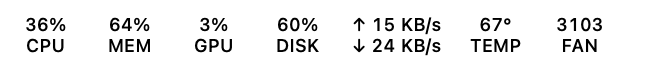

# 历史版本记录

以下记录保留各版本交付时的说明；当前能力和使用方式以 [README](../README.md) 与功能文档为准。

## 多屏显示范围（0.13.15）

「系统状态 → 菜单栏显示」新增「所有屏幕 / 仅一个屏幕」切换。单屏模式可跟随系统主显示器，也可以选择某一块已连接屏幕；默认保持原有的仅主屏行为。选定外屏断开时临时回退到主屏，重新接入后恢复原选择；所有屏幕模式随扩展屏增减自动增删入口。指标全关时的工具箱图标也遵循同一范围，指标选择、内部顺序与实时数据仍由同一份设置和监控服务提供。

范围和目标自动保存，按显示器 UUID 识别，不依赖连接顺序或当前焦点。实机切换与热插拔测试边界见 [多屏显示设计与验证](MENU_BAR_DISPLAYS.md)。

## 连续指标区与内部排序（0.13.14）

指标现在共同显示在一个紧凑、连续的菜单栏区域内。开启任意指标时隐藏主图标；全部关闭时显示工具箱图标。直接拖动或按住 ⌘ 拖动指标可调整内部顺序，开关和重启都保留排序，其他应用不会插入指标之间。区域宽度随开启项目收缩或展开，邻近应用图标可随原生布局平移，排列顺序保持不变；不保留固定宽度的空白占位。

## 菜单栏字体层级（0.13.12）

上方数值采用 11 点较醒目的字重，下方名称缩为 7.5 点。网速的上传与下载都是数值，两行统一为 10 点并继续左对齐。沿用固定列宽与紧凑间距，设置预览和实际菜单栏共用绘制逻辑。

## 状态图标默认靠左（0.13.11）

首次显示、旧版最右侧默认位置及「恢复可见位置」均改为状态图标区最左侧的可见位置。刘海屏会完整避开中间遮挡，不移入应用菜单区。已保存的有效手动拖动位置继续保留，扩展屏仍无占位。

## 紧凑指标与 M2 温度 / 风扇（0.13.10）

菜单栏沿用数值与标签的两行样式，指标内部间距为 4 点；普通内容列宽 28 点，网速内容列宽 58 点，上传与下载共用左侧起点。数值变化不会改变整体宽度，设置预览与菜单栏使用同一绘制逻辑。

修复 Apple Silicon 上未调用 SMC 读取的问题。M2 CPU 温度显示已读取核心的最高温度，风扇显示真实 RPM；0 RPM 表示当前停转，读取不到才显示「—」。当前 M2 Pro 已实测，其余芯片的 CPU 温度映射尚未逐一适配；无风扇或不提供相应键的机型仍显示不可用。仅读取，不控制风扇或新增特权组件。

## 刘海屏菜单栏位置恢复（0.13.9）

菜单栏指标会避开主屏刘海，正常的拖动位置继续保存。拖入刘海或越出屏幕时，松开鼠标后自动移回状态图标区靠左的可见位置；启动时也会修正超出可用区域的旧位置。可从「系统状态」点击「恢复可见位置」手动恢复，指标开关保持原样，扩展屏仍不占位。

## Finder 右键执行修复（0.13.8）

修复应用位于开发目录等位置时，Finder 沙盒误判主程序不存在、点击菜单没有响应的问题。操作组件由系统启动服务打开，沿用既有文件操作、确认和重名保护。启动失败时，错误明确交给所属 iTools 主窗口显示，避免旧预览应用接管链接；无需新增权限。

## 深色分区与指南入口（0.13.7）

主窗口深色模式移除卡片和分区的装饰描边，保留半透明底色。顶部指标信息框的固定底栏增加带文字的「快捷键与操作指南」入口，可直接打开分类指南并编辑快捷键。

## 快捷剪贴板滚轮与悬停筛选（0.13.6）

横向面板支持用普通鼠标滚轮左右浏览记录；搜索框旁的类型按钮悬停即筛选，点击仍然有效。筛选保留当前搜索内容，切换后从第一条匹配记录开始，数字键按当前筛选结果操作。原生横向触控板手势、淡色滚动条和打开后的数字键操作保留。

## 快捷剪贴板毛玻璃与数字操作（0.13.5）

整个快捷剪贴板浮框统一使用原生透明毛玻璃。分类按钮与记录标题使用对应的粉、绿、金、蓝、紫色，选中卡片带同色高亮边框；横向滚动条采用淡色细滑块。打开历史或短语面板后默认使用数字键操作记录；点击搜索框或按 ⌘F 才进入搜索，搜索期间数字作为输入。按 ↓ 或 Esc 返回记录选择后，再用数字键使用筛选结果。单击复制、双击粘贴和输入法组词保护保持有效。

## 多显示器指标浮框（0.13.3）

点击菜单栏指标时，信息浮框固定在本次点击所在的屏幕；快捷键则使用鼠标所在屏幕。浮框不会激活或移动主窗口，数据更新也不再改变菜单栏指标宽度或浮框位置。支持副屏位于主屏左、右、上、下的坐标布局；切换桌面或改变显示器配置时收起浮框，下一次点击重新定位。保留毛玻璃外观、快捷操作、Esc 关闭和点击外部关闭。

## 深色界面与系统状态管理（0.13.2）

深色模式的分区卡片与按钮适度提亮，保留半透明毛玻璃。窗口布局的 11 种排列及还原按钮增加对应图形，其中排列图形直接使用实际布局比例。菜单栏各项指标的开关、实时预览与说明统一移至「系统状态」页面顶部，原有配置自动保留。

## 记录点击操作（0.13.1）

主窗口剪贴板历史、快捷短语，以及浮动面板横向卡片与竖向列表统一为「单击复制、双击粘贴」。鼠标悬停显示操作说明；单击复制后浮动面板保持打开并显示「已复制」。双击与单击互斥，避免短语变量被重复展开。记录内独立按钮和右键菜单继续执行各自操作。数字键和回车仍使用原有偏好。

## 权限与粘贴流程（0.13.0）

- 权限不足时显示单一的前置授权说明窗口；不会同时弹系统授权提示与主窗口错误框。打开系统设置时让出前台，返回 iTools 后重新检测当前进程的实际授权状态。
- 分别检查辅助功能窗口控制与模拟键盘输入权限，显示正在运行的应用路径、版本、重新检测和重新打开入口。
- 粘贴等待目标应用成为前台且快捷键松开，再写入内容和发送粘贴按键；目标关闭、剪贴板被更新、激活超时或授权失败时不消耗队列。
- 窗口布局保留操作前的目标应用，区分权限拒绝、应用无响应、没有窗口和原生全屏限制。
- 首次从旧的临时签名版本升级，需要在系统设置中重新添加 `/Applications/iTools.app` 授权；应用不能代替用户勾选权限。具体恢复步骤和构建签名说明见[权限说明](PERMISSIONS.md)。

## 轻透毛玻璃界面（0.13.20）

主窗口、指标展开面板、快捷键指南、右键菜单设置及权限说明统一使用 macOS 原生材质。减轻主背景、侧栏和卡片的实色遮罩，让后方的模糊颜色自然透出；按钮保留轻微悬停与按下反馈，文字和数值保持清晰。

0.13.20 进一步减轻背景、卡片和按钮底色；主窗口侧栏采用深色原生毛玻璃、亮白文字和淡白选中底色，放大导航图标、字号和纵向间距，最小窗口仍能完整显示七个入口。

浅色与深色共用同一套轻薄卡片、圆角和层次。系统开启「减少透明度」时继续回退为实色；不会更改系统辅助功能设置。文件确认与选择对话框保留原生交互，访达后台弹窗跟随 iTools 的外观设置，预览区和进度窗口采用透明底。

## 半透明毛玻璃界面（0.12.3）

参考用户提供的 iCopy 布局，主窗口采用炭灰透明侧栏、彩色分类图标和柔和圆角卡片。分组标题位于卡片外，设置页的短内容并排显示；保留整行导航和宽内容区。

- 主窗口与顶部指标面板使用 macOS 原生毛玻璃，透出后方背景的模糊颜色，叠加轻微淡色渐变。
- 内容延伸到标题栏顶部，关闭、最小化、全屏三个原生按钮融入侧栏背景，移除单独的标题栏色带；顶部空白处仍可拖动窗口。
- 滚动条轨道透明，消除右侧和底部的实色条带；保留原生拖动、滚轮，以及系统常驻 / 自动隐藏偏好。主窗口、指标面板、快捷键和剪贴板统一处理。
- 顶部面板的快捷操作使用浅色半透明底座和彩色图标，开启时显示勾选标记，悬停采用柔和高亮。主窗口与顶部面板使用同款纤细浅色滑块，原生可拖动范围保留。
- CPU / 内存曲线、GPU / 磁盘容量条和快捷操作继续使用原有真实数据及操作入口。
- 保留「跟随系统 / 浅色 / 深色」。系统开启「减少透明度」时自动使用实色背景，保证可读性。

[完整主窗口](screenshots/overview.png) · [浅色设置](screenshots/settings.png) · [深色设置](screenshots/settings-dark.png) · [指标面板](screenshots/quick-panel.png)

## 屏幕底部剪贴板（0.10.0）

按 **⌥⌘V**，剪贴板历史以接近屏幕全宽的横向浮框显示在当前鼠标所在屏幕底部。参考用户提供的 iCopy 截图，上方集中放搜索、类型、收藏和分组，下方横向浏览内容卡片。

- 文字 / 富文本、图片和文件分别使用绿色、黄色、蓝色卡片头；显示来源应用图标、名称、时间、预览和数字编号。
- 每张卡片可直接复制或粘贴，也可用数字键、方向键、回车和双击操作。图片用缓存缩略图预览，复制仍保留原始内容。
- 根据屏幕可用宽度定位，避开可见 Dock；多屏重新呼出时跟随鼠标所在屏幕。窄屏工具栏自动分两行。
- 面板设置中可选择「屏幕底部卡片」或「竖向列表」。已有横向模式自动采用新样式，首次使用默认底部卡片，原先明确选择竖向的偏好保留。

## 更多操作菜单显示修正（0.9.1）

快捷键面板的所有功能行统一只显示「…」菜单图标，移除与三点重叠的下拉箭头，并扩大点击区域。

## 统一快捷键面板（0.9.0）

按 **⌥⌘/**，或点击主窗口侧栏「快捷键与操作指南」。查看说明与编辑设置合并在同一个面板，不再切换两种模式。

- 参考用户提供的 iCopy 布局，使用深色分类侧栏、彩色图标和分组卡片。当前 144 项功能归入 7 类，按用途继续分组；较窄窗口自动改为单列。
- 点击功能右侧的按键框即可就地录入、查看冲突并保存；行末菜单可执行功能或清除快捷键。
- **⌘F** 搜索全部分类的功能或按键，支持「仅已设置」筛选；搜索结果中也可直接编辑。
- 「剪贴板与短语」集中展示全局快捷键、面板内按键说明，以及数字修饰键、复制 / 粘贴行为和横竖布局设置。
- 原有自定义按键和 13 组默认快捷键保留。录入时暂停全局按键，取消、切换分类或离开窗口后恢复。

详情见[快捷键与剪贴板面板说明](SHORTCUTS.md)。

## 侧边栏整行点击（0.8.1）

主窗口左侧的全部 7 个导航项均可点击整行切换页面，包括图标、文字和行内空白区域。

## 开机自启动（0.8.0）

打开 **设置 → 启动设置 → 开机自启动**。开启后，登录 Mac 时只在菜单栏运行 iTools，不弹出主窗口；按已启用的模块启动剪贴板历史、系统监控及全局快捷键。手动打开应用仍显示主窗口。

- 首次使用默认关闭；开关读取系统实际状态，修改失败会显示原因，不把失败保存成「已开启」。
- macOS 13 及以上使用系统登录项接口，待系统允许时显示明确状态，可直接进入系统设置；返回应用后自动刷新。
- macOS 12 使用内置登录启动组件的兼容接口，由 iTools 内的开关管理。
- 关闭开关取消以后的自启动，不退出当前应用。退出 iTools 不会取消自启动，也不会立即被重新拉起。
- 组件随完整应用一起安装，启动时定位所在的 iTools.app；不保存开发目录路径、不添加常驻守护脚本。

详情见[自启动说明](LOGIN_ITEMS.md)。

## 自定义 Finder 一级右键菜单（0.7.0）

在 **访达与文件 → 自定义右键菜单…**，或 **设置 → Finder 右键菜单** 中，勾选要直接显示在一级菜单的操作。未勾选的继续按原分组保留在「iTools 访达工具」子菜单，选中项不会重复出现。

- 全部 47 项操作可单独设置，支持搜索、实时预览、常用预设，以及全部放到一级 / 放回子菜单。
- 一级入口带 `iTools ·` 前缀；「打开方式」仍展开系统关联应用，选定后直接交接。
- 自动保存，下次重新打开右键菜单即生效，主程序退出或电脑重启后保留；首次使用保持原有子菜单布局。
- 某分组全部移到一级后隐藏空分组；全部操作移到一级后，不保留空的 iTools 子菜单。

## Finder 启动修复（0.6.1）

修复重启后右键新建文件、进入终端等操作报「无法打开指定的文稿或 URL」。Finder 扩展现在通过系统的应用启动事件向后台组件传递请求，不再将未声明的内部 URL 交给系统打开。主程序未运行时也可直接执行，不需要先打开 iTools。

同时禁止用其他安装路径的旧进程替代当前组件，启动失败仅显示一个带错误码的提示。开发验证增加与 Finder 扩展相同沙盒授权的发送器，覆盖首次启动和连续操作。

## Finder 系统联动（0.6.0）

右键操作优先使用 Finder / macOS / 目标应用已有能力。普通操作直接执行；必要输入集中在一个窗口，结果已在 Finder 可见时不再显示成功确认。

- **打开方式**在右键中直接列出系统关联应用，多选只显示全部文件都能使用的应用；选定后立即交给它打开，也可使用默认应用。
- **剪切 / 粘贴移动**使用标准系统文件剪贴板，接受 Finder 拷贝的文件；剪切后也可在 Finder 用 **⌥⌘V** 移动。复制其他内容后，旧的剪切记录不会再被使用。
- **移到废纸篓**交给 macOS 处理，不增加 iTools 确认或重复进度窗。压缩并移到废纸篓在完整性校验、原件快照检查通过后直接完成。
- **重命名 / 乱码修复**在同一窗口输入、查看预览并应用；**彻底删除**显示文件清单，点击二次确认即可执行，无需手动输入文字。
- **压缩校验**先检查压缩包，只有确实需要密码时才询问；未加密文件不用再提交空密码。
- 常用目录 / 文档模板只有一个候选时直接使用；需要选择目录、文件或应用时，才显示系统选择器或一次选择面板。

全部 47 项菜单的系统联动与回退处理见[右键操作说明](FINDER_MENU.md)。

## Finder 直接操作（0.5.0）

- 右键新建 TXT / Markdown / RTF / JSON / HTML / CSV / XML，直接在目标目录生成「未命名」文件并在 Finder 选中；重名自动编号，可按回车重命名。
- 进入终端、复制路径 / 名称、剪切与粘贴移动、隐藏 / 显示、创建同名文件夹等直接执行，不打开 iTools 主窗口。
- ZIP / 7z 预设直接保存到所选项目旁边，重名自动编号；加密只需输入密码。自定义压缩仍可设置选项及保存位置。
- 移动 / 复制只选择目标目录；模板、图标、打开方式只显示对应选择器。重命名与彻底删除保留必要的专用对话框；权限变更和解散直接执行；扫描 / 哈希使用独立结果窗口。
- 主程序退出后右键仍可用。访达操作组件独立运行，连续操作按顺序处理，30 分钟未操作后退出并清除内存密码；文件剪贴板由系统管理，仍可由 Finder 或其他应用使用。

继续保留 0.4.1 的菜单编号路由、安装路径定位和启动错误提示。退出主程序不会自动停用系统管理的 Finder 扩展。

## 全局快捷键与剪贴板面板（0.4.0）

- **⌥⌘V**：打开 / 收起独立剪贴板历史；**⌥⇧⌘V**：打开快捷短语。
- **⌥⌘/**：在其他应用上方打开快捷键操作指南；**⌃⌥Space**：打开顶部工具面板。
- 设置 →「快捷键与操作指南」中搜索全部功能、录入组合键、清除或恢复默认。常用操作已有预设，其他操作按需分配；冲突会明确提示。
- 历史面板支持竖向列表 / 横向卡片、文字 / 图片 / 文件筛选、分组、收藏和搜索；主窗口与浮动面板均支持单击记录复制、双击记录粘贴，悬停显示操作提示；浮动面板单击复制后保持打开。
- **1–9、回车**默认直接粘贴，可改为仅复制；鼠标双击固定为粘贴。支持数字修饰键。**⌘F** 搜索、方向键选择、**⌘C** 复制、**⇧⌘C** 纯文本复制、**Esc** 退出搜索或关闭面板。搜索框和输入法组词时不劫持裸数字。
- 粘贴回到呼出面板时的应用，需要辅助功能权限。复制和查看不需要此权限。仍需用户主动开启历史记录。

完整行为、默认按键、适用范围见[快捷键与剪贴板面板说明](SHORTCUTS.md)。

## 顶部快捷面板（0.3.0）

左键点击顶部 iTools 图标或任意指标，打开 **实时状态 + 快捷操作** 面板；右键保留文字菜单。包含 5 个系统应用入口、23 个可选操作（默认显示 15 个），支持在面板右上角「编辑」中增减和排序，修改自动保存。

常用操作包括防止自动休眠、保持亮屏、系统深色、锁屏、屏保、清洁屏幕/键盘、桌面遮罩、Dock/菜单栏自动隐藏，以及截图、OCR、剪贴板、访达工具。面板底部显示开机时间；录制和防休眠进行中会出现停止入口。

详见[快捷面板说明](QUICK_PANEL.md)。防止自动休眠不保证合盖运行；清洁模式有 Esc 长按、鼠标结束和一分钟超时出口，首次使用需辅助功能授权。系统外观/Dock/菜单栏操作可能请求自动化授权。

## 访达右键菜单（0.2.0）

在 Finder 中右击文件或空白处，进入 **iTools 访达工具**。五组操作与主程序保持一致，0.5.0 起直接执行对应操作。需要先在「访达与文件 → 启用访达扩展」中启用 iTools Finder。

截图菜单的来源和本版逐项补齐内容见[右键菜单对照表](FINDER_MENU.md)。FastZip 和 iRightMouse 自己的菜单不会被 iTools 禁用。

内置 7-Zip 26.03，已从源码编译为 macOS 12 / Intel 与 Apple Silicon 通用版本。密码仅保留在会话内；ZIP 密码限英文/数字/半角符号，7z 可用中文密码。通用压缩包不保证保留 macOS 资源分叉/扩展属性；「压缩后移除」经完整性校验及快照检查后将原件移到系统废纸篓。

## 顶部菜单栏指标（0.1.1）

在 **系统状态 → 菜单栏显示** 中，分别开启 CPU、内存、GPU、磁盘、网速、温度和风扇。也可点击工具箱图标，在「菜单栏显示」子菜单中直接切换。

- 修改立即生效并自动保存；全部关闭后保留工具箱图标，默认只显示 CPU。
- CPU / MEM / GPU / DISK 使用原来的两行样式：上方数值、下方标签，磁盘为已用空间比例；各列固定宽度、统一间距。网速上方上传、下方下载，两行左对齐，显示完整速率单位并按 1000 进制换算。拥挤时可在「系统状态 → 菜单栏显示」恢复可见位置。
- 已开启的指标组成一个连续原生菜单项，主图标隐藏；全部关闭时显示主图标。可直接拖动或按住 ⌘ 拖动，在区域内排序；点击打开快捷面板，右键打开文字菜单。内部顺序单独保存，开关指标只改变区域内内容与宽度。
- 工具箱与指标默认仅在 macOS 主显示器显示，可在系统状态页切换所有屏幕或指定单屏；非目标屏不保留空白占位或鼠标入口，显示器热插拔后自动适配。
- 暂停系统监控后显示「—」，不继续展示旧读数；GPU/传感器不可用时也不伪装成 0%。
- GPU 读取驱动的 IORegistry PerformanceStatistics，多显卡取最高值。当前 Intel 与 AMD 双显卡已实测；未提供统计数据的驱动会显示不可用。

