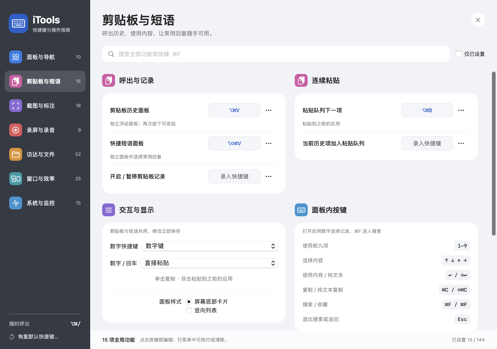
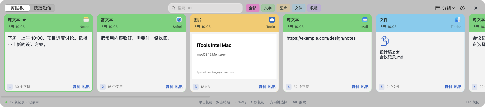

# 快捷键与独立剪贴板面板

适用于 iTools 0.10.0，Intel / macOS 12+。原生 Carbon 全局快捷键 + AppKit 浮动面板 + SwiftUI 内容；不安装键盘驱动。

## 从哪里打开

按 **⌥⌘/** 随时打开 / 收起「快捷键与操作指南」。也可从设置页、菜单栏文字菜单、顶部快捷面板的键盘按钮或主窗口侧栏打开。所有入口共用同一个可查看、编辑与执行的面板，不再区分指南和设置模式。窗口工具中的入口直接定位「窗口与效率」，剪贴板面板中的入口直接定位「剪贴板与短语」。

指南只列出 **iTools 自身功能**，不是其他应用的菜单快捷键扫描器。当前提供 144 个功能；0.12.3 移除了应用集成页面及四个原应用启动快捷键，其余功能 ID 和自定义按键保留，已移除操作的旧按键不再注册或占用组合键；旧设置入口的自定义按键作为「快捷键面板（备用）」继续打开同一面板。

## 分类与就地编辑

左侧整行可点击，包含「面板与导航、剪贴板与短语、截图与标注、录屏与录音、访达与文件、窗口与效率、系统与监控」7 类。右侧按用途展示卡片，例如剪贴板的「呼出与记录 / 连续粘贴」、录制的「开始录制 / 录制控制 / 导出与转换」。宽窗口双列，较窄窗口单列，支持浅色和深色外观。

1. 选择分类，点击功能右侧的按键框。
2. 按下组合键，在原行查看结果；重复或不可用的组合直接显示原因。
3. 点击「保存」。按 Esc 或点击「取消」放弃本次修改。

行末「…」菜单可「打开 / 执行此功能」或「清除快捷键」。左下角可恢复整套默认按键，恢复前会确认。

**⌘F** 聚焦搜索；输入后跨所有分类搜索标题、分组、说明和按键，多个空格分隔的词需同时匹配。「仅已设置」可与分类或搜索组合使用。搜索结果保持分组且可直接编辑；无匹配时提供清除筛选入口。Esc 先清空搜索，再关闭面板并返回之前的应用；录入期间 Esc 只取消编辑。

「剪贴板与短语」还包含「交互与显示」和「面板内按键」卡片：可直接修改数字修饰键、数字 / 回车后的复制或粘贴行为、横竖布局。它们与原剪贴板设置共用偏好，修改立即保存；面板内按键说明随数字修饰键同步更新。内置的方向键、复制、搜索等仅在剪贴板面板内生效，不占用全局按键。

[深色外观](screenshots/shortcut-guide-dark.png) · [行内修改及冲突提示](screenshots/shortcut-editing.png) · [跨分类搜索](screenshots/shortcut-search.png)

## 默认按键

| 功能 | 默认按键 |
|---|---|
| 快捷键操作指南 | ⌥⌘/ |
| 顶部工具面板 | ⌃⌥Space |
| 剪贴板历史面板 | ⌥⌘V |
| 快捷短语面板 | ⌥⇧⌘V |
| 粘贴队列下一项 | ⌥⌘B |
| 区域截图 | ⌥⇧4 |
| 主屏截图 | ⌥⇧3 |
| 屏幕文字识别 | ⌥⇧T |
| 左 / 右半屏 | ⌃⌥← / ⌃⌥→ |
| 最大化 / 还原窗口 | ⌃⌥↑ / ⌃⌥↓ |
| 停止并保存录制 | ⌃⌥S |

所有现有工具入口、快捷操作、11 种窗口布局、截图与标注工具、录制操作、剪贴板管理、完整 Finder 操作、菜单栏指标开关和系统 / 集成应用入口均在设置中登记。常用操作预设以上 13 组，其余初始为「未设置」，可自行分配；没有为删除、清空等操作自动占用按键。

「打开临时便笺 / 链接清理 / 二维码生成」定位对应编辑工具，让用户填写参数。文件快捷操作重新选择本次文件或目录，避免使用旧选择；不读取 Finder 的私有状态。破坏性操作继续使用已有确认流程。带“当前”字样的图像操作使用正在编辑的图片；没有图片时提示先打开图片。剪贴板当前项操作在面板未打开时仅打开面板，供用户选择。

## 设置规则

点击某项右侧按键，直接按组合键并保存；可清除或恢复整套默认值，修改自动持久化。录入期间暂停 iTools 全局快捷键，完成 / 取消、切换分类或筛选、离开或关闭面板后恢复。未保存的候选不会覆盖原组合。组合至少包含 Command / Option / Control。Esc、Tab、纯文字按键和常见编辑组合不允许作为全局绑定。

应用内重复组合会指出冲突功能；系统注册失败时保留原组合，并在当前编辑行显示错误。启动时无法注册的按键也会标红。macOS 某些系统保留组合或其他应用事件拦截不一定由 Carbon 报告，请优先更换组合，或调整对应应用 / 系统的设置。显示名称按标准键盘的物理键位；非标准布局需按实际按键测试。

配置只在本机 UserDefaults 保存，不记录用户输入。iTools 必须保持运行；锁屏、安全输入、系统保留界面或应用独占键盘时，全局按键可能不可用。

## 独立剪贴板

无需打开主窗口。**⌥⌘V** 呼出 / 收起历史，**⌥⇧⌘V** 呼出快捷短语。首次默认「屏幕底部卡片」：在鼠标所在显示器底部展示近全宽浮框，位于屏幕可用区域内，避开可见 Dock。打开期间固定在该显示器底部，显示器配置变化时重新定位；关闭后再次呼出会重新选择鼠标所在屏幕。

上方为搜索、全部 / 文字 / 图片 / 文件 / 收藏筛选，以及分组、设置与关闭入口。窄屏工具栏改为两行。整个面板使用原生透明毛玻璃，分类按钮保持粉 / 绿 / 金 / 蓝 / 紫底色；下方卡片的亮色标题与类型一致，选中时增加同色描边，底部横向滚动条为淡色。来源应用图标与名称、时间、内容预览、编号和复制 / 粘贴按钮集中展示。图片预览使用缩略图，复制和粘贴仍使用原始表示，富文本格式不会因预览而被清除。

横向模式下，鼠标滚轮可直接左右浏览记录；悬停或点击类型按钮即可筛选。打开后默认选择记录，可直接用数字键或方向键操作。点击搜索框或按 Command + F 进入搜索，此时数字用于筛选；按 ↓ 或 Esc 返回记录选择。中文输入法组词期间，方向键及回车交给输入法处理。

[深色外观](screenshots/clipboard-horizontal-dark.png) · [窄屏布局](screenshots/clipboard-bottom-narrow.png)

面板齿轮菜单、主设置或统一快捷键面板中可以切换「屏幕底部卡片 / 竖向列表」，立即保存。旧横向偏好自动对应底部卡片，已保存的竖向选择保留。竖向列表继续在鼠标附近呼出并可拖动。面板可在普通应用和全屏应用所属空间显示；不同实机的多屏与原生全屏交互仍需实际验收。

单击记录复制并选中，浮动面板保持打开；双击记录粘贴到之前的应用，悬停显示操作提示。主窗口历史、快捷短语与横竖浮动面板使用相同行为。卡片按钮和竖向面板底栏也可复制或粘贴。右键可纯文本复制 / 粘贴、收藏、加入队列或删除。快捷短语在同一独立面板切换显示，支持日期、时间及当前剪贴板变量。

| 面板内按键 | 操作 |
|---|---|
| 1–9 | 使用当前筛选结果的前九项；不是屏幕内可见项目重新编号 |
| 上 / 下 / 左 / 右 | 浏览时选择前一项或后一项并自动滚动；搜索时上 / 下进入记录选择，左 / 右移动文字光标 |
| 单击记录 | 复制；浮动面板保持打开 |
| 双击记录 | 粘贴到之前的应用 |
| 回车 | 按偏好直接粘贴或仅复制 |
| Shift + 回车 | 按偏好使用纯文本（文字记录） |
| Command + C | 复制选中项 |
| Shift + Command + C | 纯文本复制 |
| Command + P | 收藏 / 取消收藏历史项 |
| Command + F | 聚焦搜索框 |
| Esc | 退出搜索；再次按下关闭面板并返回原应用 |

数字可加 Command / Option / Control / Shift 修饰键；动作可选直接粘贴或仅复制。裸数字或 Shift 数字在搜索框中正常输入，输入法正在组词时不触发快捷选择或回车粘贴。搜索框聚焦时 Command + C 仍用于复制搜索文字，退出搜索后作用于选中记录。

查看和复制无需辅助功能权限；直接粘贴需要该权限，首次点击时请求。未授予时可先复制，再在目标输入框按 Command + V。粘贴固定返回呼出面板时的应用，随后检查目标仍在前台且剪贴板未变化，才发送 Command + V；不向后台应用盲发。此功能恢复应用焦点，不保存网页 DOM 或文本光标位置，目标应用仍负责保留其原输入焦点。

历史监听继续默认关闭，仅在用户开启后保存新的复制内容；排除应用、保密剪贴板标记、保留期限和容量限制沿用原有规则。面板没有云同步，也没有读取其他剪贴板软件的数据库。

## 参考与实现

独立剪贴板交互参考 [iCopy 官方介绍](https://www.aodo365.com/icopy.html)及开发者维护的 [App Store 介绍与更新记录](https://apps.apple.com/cn/app/id1638023723)。0.9.0 的统一快捷键面板依据用户提供的 iCopy 设置截图，采用分类侧栏和分组卡片结构。本项目独立实现，不包含 iCopy 的程序或素材。
